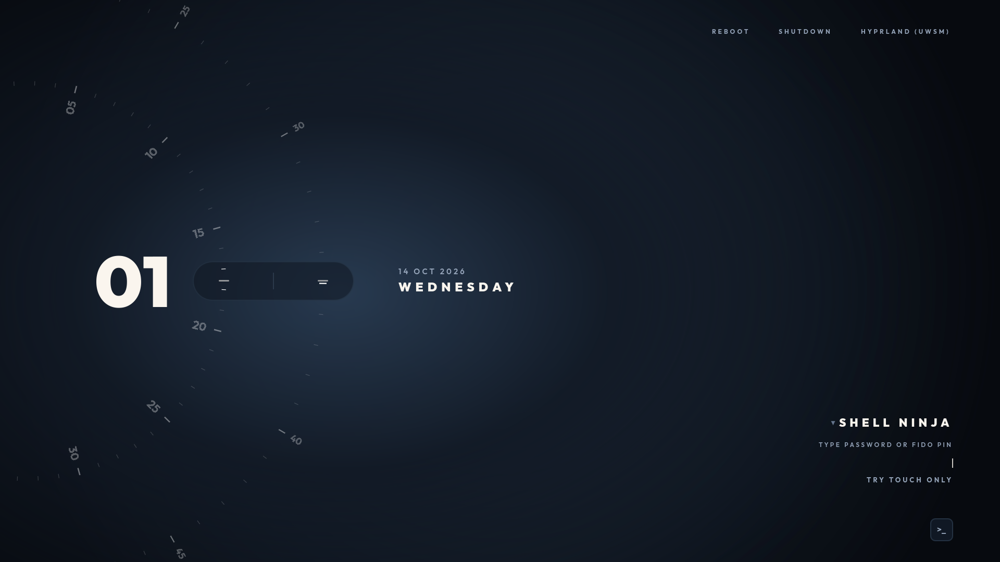
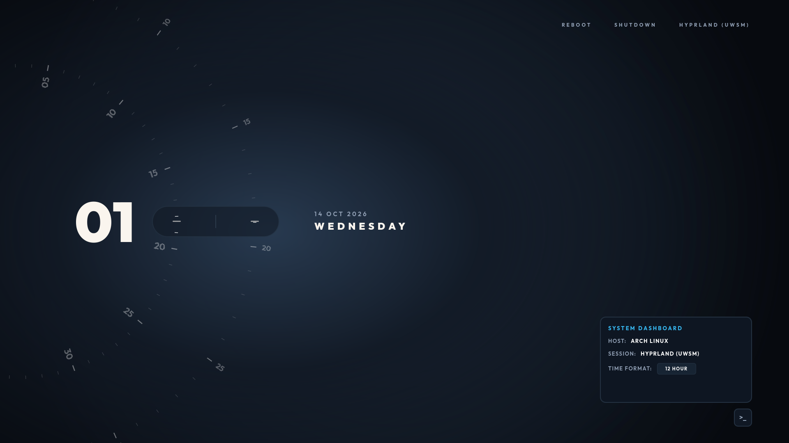

# Prohori (প্রহরী) — SDDM Theme

A minimalist, high-performance, and futuristic SDDM Qt6 theme designed with rotating concentric dials, clean typography, and zero visual clutter.

---

## Previews

### Main Lockscreen View


### System Dashboard Flyout


---

## About the Name

**Prohori** (প্রহরী, pronounced *pro-ho-ri*) is a Bangla word with dual significance:

- **Prohor (প্রহর)**: An ancient unit of time in Bengal denoting the watches of the day and night.
- **Prohori (প্রহরী)**: The **Sentinel, Sentry, or Gatekeeper** who guards access to a stronghold and authorizes entry.

Together, it represents a timepiece that acts as the vigilant gatekeeper to your desktop.

---

## Inspiration & Credits

This theme was inspired by the **Ryoku** lockscreen and login environment design. Special thanks to the Ryoku ecosystem and the Linux ricing community for the original dial clockwork layout concept.

---

## Features

- **Orbital Dial Clock**:
  - Live rotating concentric tracks for minutes and seconds with dynamic spotlight illumination.
  - Symmetrical indicator capsule pill featuring dual alignment ticks and a center divider.
  - Large bold hour counter (supports both 12-hour and 24-hour modes).
  - Clean uppercase date and day-of-week display.
- **Display & Hardware Optimization**:
  - **All Resolutions**: Proportional dynamic scaling that fits cleanly across 720p, 1080p, 2K (1440p), 4K (2160p), 16:10 laptop screens, and 21:9 ultrawide monitors without clipping.
  - **High Refresh Rate Sync**: Powered by Qt's native `FrameAnimation` synchronized directly with your display's VSync loop (60Hz, 75Hz, 120Hz, 144Hz, 165Hz, 240Hz+).
- **Minimalist Top Navigation**:
  - Session selector with dropdown menu and native support for `HYPRLAND (UWSM)`, standard Hyprland, KDE Plasma, GNOME, Sway, and Niri.
  - Direct Reboot and Shutdown controls wired into SDDM.
- **Bottom-Right Login Form**:
  - Username display with multi-user dropdown support (auto-detects and prioritizes the primary user).
  - Clean bullet-masked (`•`) password input with vertical pulsing needle cursor.
  - `TYPE PASSWORD OR FIDO PIN` subtitle and `TRY TOUCH ONLY` prompt.
  - Smooth login transition with shake animation and `ACCESS DENIED` feedback on invalid attempts.
  - Suppressed virtual keyboard popup by default (preserves dial clock visuals without overlay obstructions).
- **System Dashboard (`>_`)**:
  - Corner badge toggling a quick flyout drawer displaying system hostname, session type, and a live 12h / 24h toggle.
- **Zero External Font Dependencies**:
  - Bundled typography (`Outfit` static weights: Regular, Medium, SemiBold, Bold, and Black) in `fonts/`.
  - Built-in atmospheric dark radial gradient in `backgrounds/`.

---

## Dependencies & Prerequisites

Prohori is built for **SDDM with Qt 6** (`sddm-greeter-qt6`). The installation script handles dependency installation automatically, or you can install them manually using your distribution's package manager:

### Arch Linux / CachyOS / EndeavourOS
```bash
sudo pacman -S --needed sddm qt6-declarative qt6-5compat qt6-svg
```

### Debian / Ubuntu / Linux Mint / Pop!_OS
```bash
sudo apt update
sudo apt install -y sddm qml6-module-qtquick qml6-module-qtquick-controls \
    qml6-module-qtquick-layouts qml6-module-qt5compat-graphicaleffects qt6-declarative-dev
```

### Fedora / RHEL / Nobara
```bash
sudo dnf install -y sddm qt6-qtdeclarative qt6-qt5compat qt6-qtsvg
```

### openSUSE (Tumbleweed / Leap)
```bash
sudo zypper in sddm qt6-declarative qt6-declarative-imports qt6-qt5compat qt6-svg
```

### Void Linux
```bash
sudo xbps-install -S sddm qt6-declarative qt6-5compat qt6-svg
```

### Alpine Linux
```bash
sudo apk add sddm qt6-qtdeclarative qt6-qt5compat qt6-qtsvg
```

---

## Installation

### Automated Install (Recommended)
The included `install.sh` script automatically detects your Linux distribution, installs any missing packages, installs the theme to `/usr/share/sddm/themes/prohori`, installs the bundled fonts system-wide, and activates the theme in `/etc/sddm.conf.d/theme.conf`.

```bash
chmod +x install.sh
./install.sh
```

#### Installer Flags
- **`./install.sh`**: Automatic detection, dependency install, theme install, and SDDM activation.
- **`./install.sh --check`**: Check if all dependencies are satisfied without making changes.
- **`./install.sh --no-deps`**: Skip package manager checks and only copy/activate the theme.

---

## Testing / Live Preview

To test and interact with the theme in a preview window without logging out or rebooting:

```bash
./test.sh
```

---

## Customization (`theme.conf`)

Edit `theme.conf` in the theme directory to customize options:

```ini
[General]
# Visual mode: "dark" or "light"
themeMode="dark"

# Clock format: "12" or "24"
hourFormat="12"

# Background wallpaper image (path relative to theme root, or absolute path)
background="backgrounds/default.jpg"

# Login animation
enableWindup=true

# Virtual on-screen keyboard: false (default, keeps keyboard closed) or true
enableVirtualKeyboard=false

# Authentication text labels
authSubtitle="TYPE PASSWORD OR FIDO PIN"
authPrompt="TRY TOUCH ONLY"

# Color Palette
mainTextColor="#faf5ee"
dimTextColor="#6b7c93"
subTextColor="#94a3b8"
accentColor="#38bdf8"
errorColor="#f87171"
```

---

## Virtual Keyboard Behavior & Troubleshooting

By default, Prohori keeps the virtual on-screen keyboard closed and suppressed so that the clock dial artwork is never obstructed when the password input gains focus.

### Native Theme Control
In `theme.conf`, `enableVirtualKeyboard=false` ensures that the virtual keyboard remains hidden on focus and click events. If you are on a touchscreen-only device and want the on-screen keyboard to pop up on focus, set:
```ini
enableVirtualKeyboard=true
```

### Global SDDM Input Method Configuration
If your system previously had a global SDDM drop-in enabling Qt Virtual Keyboard (for example `/etc/sddm.conf.d/virtualkbd.conf` with `InputMethod=qtvirtualkeyboard`), the `install.sh` script automatically neutralizes it by configuring `InputMethod=` in SDDM drop-in rules.

To verify or manually disable the virtual keyboard globally in SDDM:
Check `/etc/sddm.conf.d/theme.conf` or `/etc/sddm.conf.d/virtualkbd.conf`:
```ini
[General]
InputMethod=
```
*(Leaving `InputMethod=` empty instructs SDDM not to instantiate the virtual keyboard daemon).*

---

## Directory Structure

```
prohori/
├── Main.qml             # Core QML interface and dial engine
├── metadata.desktop     # SDDM theme metadata
├── theme.conf           # User-customizable settings
├── test.sh              # Live preview script using sddm-greeter-qt6
├── install.sh           # One-step multi-distro installer script
├── screenshots/         # Documentation screenshots
│   ├── main.png
│   └── dashboard.png
├── backgrounds/         # Default background and custom wallpaper support
│   ├── default.jpg
│   └── default.png
└── fonts/               # Bundled Outfit font files
    ├── Outfit-Black.ttf
    ├── Outfit-Bold.ttf
    ├── Outfit-Medium.ttf
    ├── Outfit-Regular.ttf
    └── Outfit-SemiBold.ttf
```
